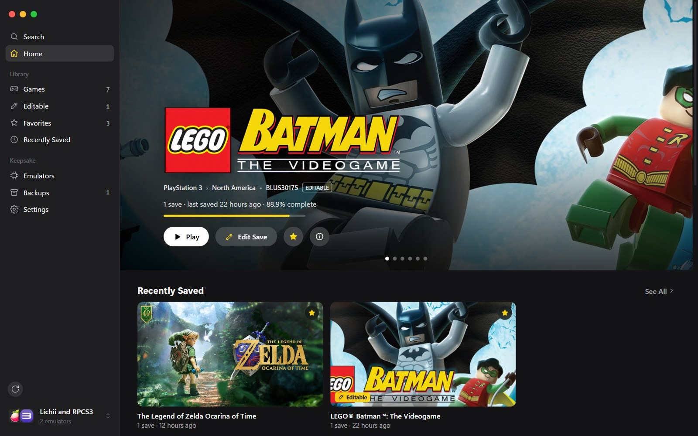
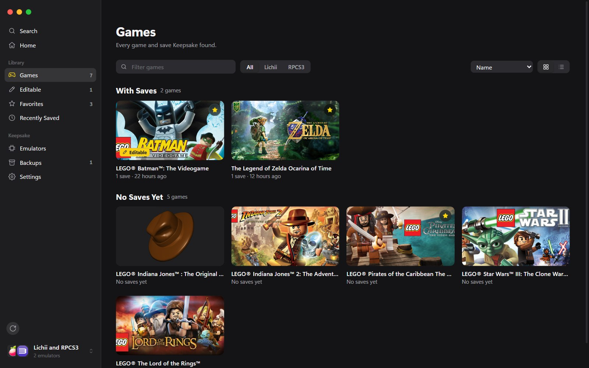
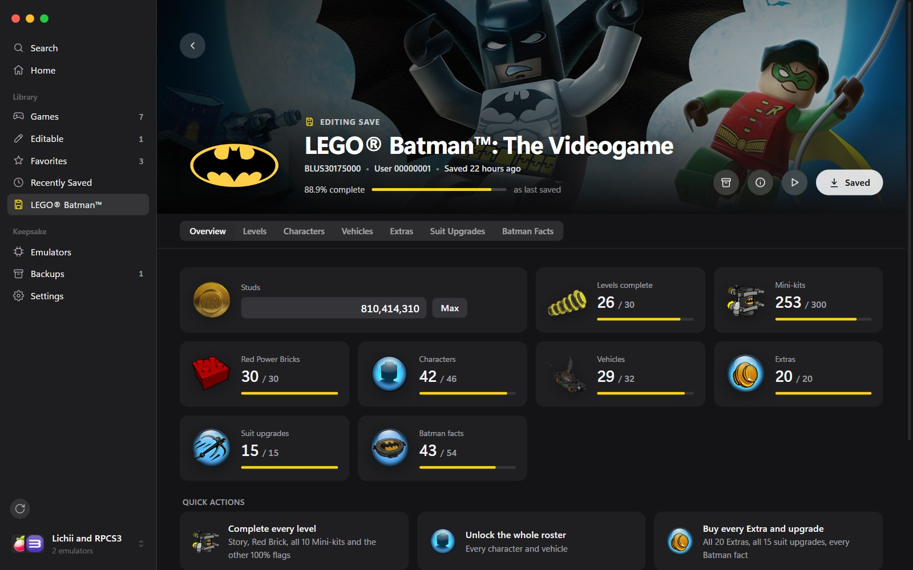
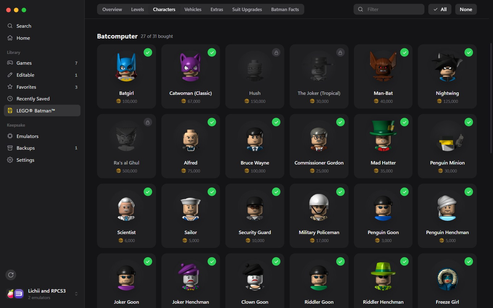
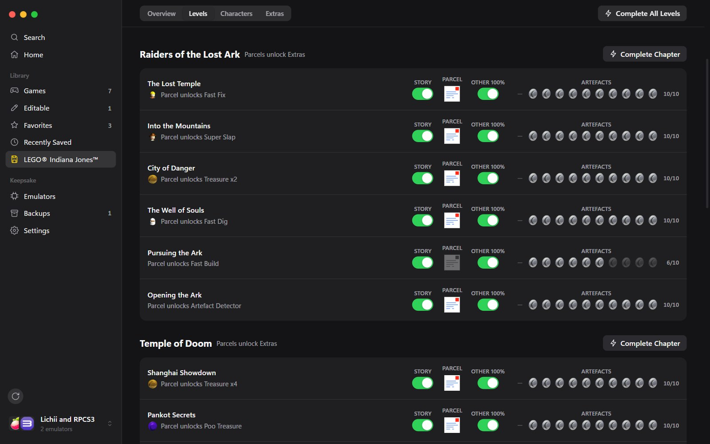

# Keepsake

Find your emulator saves and edit them, with each game's own artwork. A small native app for Windows 10 and 11, by PG.

**[Download the latest release](https://github.com/lilpatter/keepsake/releases/latest)**: `Keepsake_<version>_x64-setup.exe` installs it, `keepsake.exe` runs without installing.

More at [lilpatter.github.io/keepsake](https://lilpatter.github.io/keepsake/).

## What it does

- **Your emulators, in one library.** RPCS3 (PlayStation 3) and Lichii (Nintendo Switch and Switch 2), together. Keepsake finds each emulator and its games, and lists every save, for every RPCS3 user and Lichii profile.
- **Play.** Start any game straight from Keepsake, without the emulator's game list, full screen if you like.
- **Edit saves.**
  - **LEGO Batman: The Videogame**: studs, every level's story, Red Power Brick, Mini-kits and 100% flags, all 46 characters and 32 vehicles, all 20 Extras, all 15 suit upgrades and all 54 Batman facts.
  - **LEGO Indiana Jones: The Original Adventures**: studs, every level's story, parcel, Artefacts and 100% flags, the bonus levels, all 83 characters and all 24 Extras.
- **Real artwork.** Portraits, shop icons and pickups come from your own copy of each game. Library art comes from Nintendo, the Steam store and, with your own key, SteamGridDB.
- **Backups.** Every save is copied before Keepsake changes it. Restore any backup in one click.

## Screenshots

  
  
  
  

## Requirements

Windows 10 or 11 with the WebView2 runtime, which ships with Windows 11.

Keepsake is a Windows app. There's no Mac version yet: the Mac-style sidebar and window buttons are just part of its design.

## Updates

Keepsake updates itself from this page's releases and checks each download against GitHub's SHA-256 digest. Turn it off under Settings › About.

## Credits

Made by [PG](https://lilpatter.github.io).

Not affiliated with the RPCS3 or Lichii projects, Nintendo, Sony Interactive Entertainment, Warner Bros. Games, TT Games or the LEGO Group.

---

© 2026 PG. All rights reserved. Keepsake is free to download and use. Its source code is not public.
